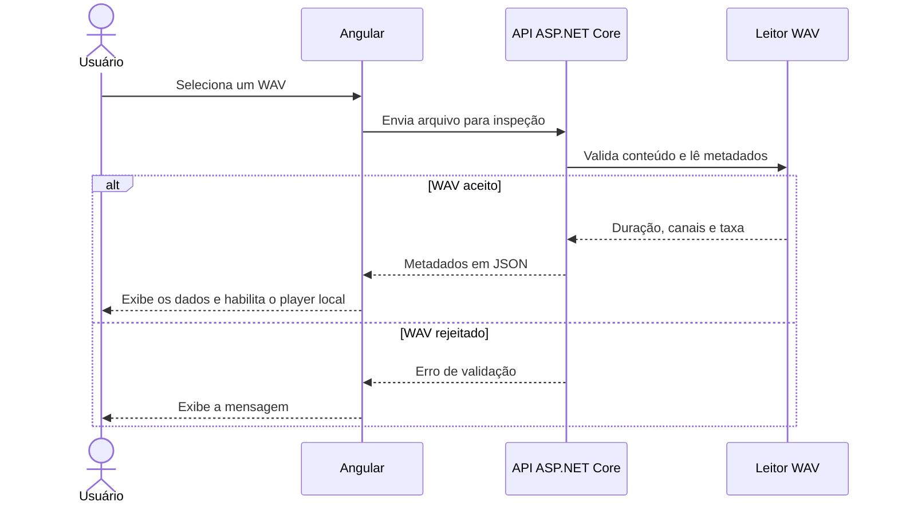

# Fluxos e contratos

## Importação, inspeção e reprodução

Se o usuário selecionar outro arquivo durante a inspeção, a interface cancela a requisição anterior e libera a URL de reprodução quando substitui o áudio.

## Seleção e análise do trecho

1. Na etapa de forma de onda, `inspect` passará a incluir mínimos e máximos por bloco. A interface desenhará o gráfico e permitirá selecionar um intervalo dentro da duração do arquivo.
2. Ao solicitar o espectro, a interface enviará novamente o WAV com o início e o fim da seleção. A API validará o arquivo e o intervalo.
3. O motor extrairá as amostras, combinará os canais se o arquivo for estéreo, aplicará a janela de Hann e calculará a FFT.
4. A API devolverá frequências, magnitudes e, quando houver sinal suficiente, a frequência dominante. A interface desenhará o espectro e destacará o pico.

## Contrato HTTP

| Operação | Estado | Entrada | Saída |
| --- | --- | --- | --- |
| `GET /api/health` | Implementada | Sem corpo | JSON com `status` igual a `ok`. |
| `POST /api/audio/inspect` | Implementada para metadados | `multipart/form-data` com o campo `file` | `durationSeconds` em segundos, `channels` e `sampleRateHz` em Hz. A forma de onda entra na etapa 3. |
| `POST /api/audio/analyze` | Planejada | WAV, início e fim do trecho em segundos | Espectro, frequência dominante e parâmetros de análise, com unidades explícitas. |

| Resposta de inspeção | Condição |
| --- | --- |
| `200 OK` | WAV PCM de 16 bits, mono ou estéreo, dentro dos limites. |
| `400 Bad Request` | Arquivo ausente, vazio ou com conteúdo inválido. |
| `413 Payload Too Large` | Arquivo acima de 20 MiB ou com duração acima de 120 segundos. |
| `415 Unsupported Media Type` | Codificação, profundidade de bits ou quantidade de canais fora do recorte. |

A análise deverá distinguir intervalo inválido de formato incompatível e limite excedido. A validação usa o conteúdo do arquivo. A política do MVP é liberar recursos, descartar temporários e manter o áudio fora dos logs. Os gráficos devem ter controles por teclado e resultados textuais equivalentes.
