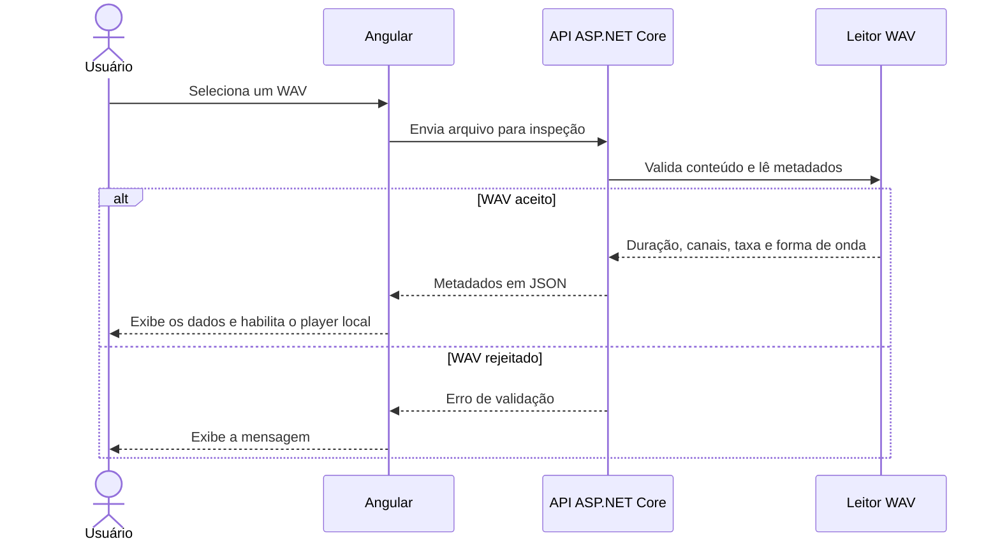

# Fluxos e contratos

## Importação, inspeção e reprodução

Se o usuário selecionar outro arquivo durante a inspeção, a interface cancela a requisição anterior e libera a URL de reprodução quando substitui o áudio. O painel permite cancelar ou remover o arquivo. Inspeção e análise têm limite de espera de 30 segundos.

## Seleção e análise do trecho

1. A interface desenha os mínimos e máximos por bloco e permite selecionar um intervalo no gráfico ou informar início e fim nos campos.
2. Ao clicar em **Analisar trecho**, a interface reenvia o WAV com o início e o fim da seleção. A API valida o arquivo e aceita de 4 a 524.288 amostras por canal, com duração de até 5 segundos.
3. O motor extrai as amostras, combina os canais se o arquivo for estéreo, remove a média, aplica a janela de Hann e calcula a FFT.
4. A API devolve até 1.024 pontos, preservando o maior pico de cada faixa, e informa a frequência dominante quando há componente alternada. A interface desenha o espectro e destaca o pico.

## Contrato HTTP

| Operação | Estado | Entrada | Saída |
| --- | --- | --- | --- |
| `GET /api/health` | Implementada | Sem corpo | JSON com `status` igual a `ok`. |
| `POST /api/audio/inspect` | Implementada | `multipart/form-data` com o campo `file` | `durationSeconds` em segundos, `channels` e `sampleRateHz` em Hz. O campo `waveform` contém os blocos com `min` e `max` normalizados. |
| `POST /api/audio/analyze` | Implementada | `multipart/form-data` com `file`, `startSeconds` e `endSeconds` em segundos | `dominantFrequencyHz` (ou `null`), `sampleCount`, `fftSize`, `binSpacingHz`, `nyquistHz` e `points` com `frequencyHz` e `magnitude` linear. |

| Resposta de inspeção | Condição |
| --- | --- |
| `200 OK` | WAV PCM de 16 bits, mono ou estéreo, dentro dos limites. |
| `400 Bad Request` | Arquivo ausente, vazio ou com conteúdo inválido. |
| `413 Payload Too Large` | Arquivo acima de 20 MiB ou com duração acima de 120 segundos. |
| `415 Unsupported Media Type` | Codificação, profundidade de bits ou quantidade de canais fora do recorte. |

A análise retorna `400` para intervalo inválido e aplica as mesmas validações de arquivo da inspeção. A validação usa o conteúdo do arquivo. A política do MVP é liberar recursos, descartar temporários e manter o áudio fora dos logs. Os gráficos devem ter controles por teclado e resultados textuais equivalentes.

As mensagens, os estados de carregamento e os controles estão descritos em [Interface e operação](interface.md).
